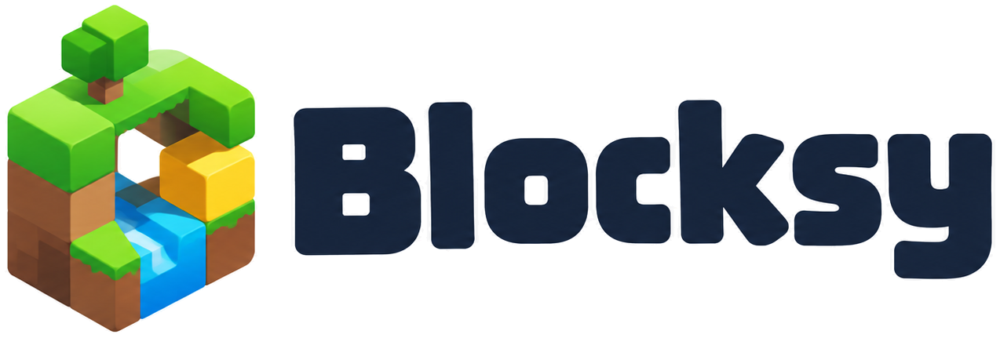

<p align="center"></p>

# Blocksy

Multiplayer block-building sandbox built with React Three Fiber and Colyseus. Players start on the island **Sunny Isle**.

A Minecraft-inspired multiplayer building game in the browser, modelled on the supplied reference images.
All textures, characters and icons are original and generated in code. No Minecraft assets are used.

## Features (phase one)

- **World**: a voxel island ("Sunny Isle"). It has layered cliffs, a stone plaza with a lantern pillar and a large oak, dirt paths with stepping stones, two shop stalls (Blocks / Decor) with striped awnings and shopkeepers, fenced "Build Here" plots, trees, lantern posts, a dock, floating islets, sea, square sun, clouds and seagulls.
- **Player**: walk, sprint, jump (coyote time and jump buffering, no double jumps), gravity, and voxel collision with walls and ceilings. Falling into the sea respawns you.
- **Camera**: first and third person (**V**). The transition is blended, so it never snaps. The third-person camera has shoulder offset and collision. In first person your body is hidden but still casts a shadow, and a first-person arm holds the selected block.
- **Building (opt-in build mode)**: hands are empty by default, so clicking never edits the world by accident. Press **T** to open the build menu and choose up to 9 blocks from your bag (owned blocks) for keys **1–9**. Key **0** is always the **destroy** tool (hammer). Pressing a number holds that block or tool; pressing it again (or **Q**) puts it away. **Left click** uses what's in hand: place the block or destroy the target. Holding the button repeats. The crosshair targets blocks with a voxel ray cast; a teal outline (orange for destroy) marks the target and a ghost preview shows where the block will go. The game:
  - checks reach;
  - stops you placing inside any player;
  - replaces flowers and grass when you build on them;
  - protects the island base and the stalls.
- **Shop**: blocks are bought at the stalls (**E**) or with **B**. A block is bought once and owned forever, with no item counts. Every price is currently 0. Prices and a coin balance already exist for a later economy.
- **Hotbar**: 9 block slots plus slot 0 (destroy). Use 1–9 / 0, or the mouse wheel while building.
- **Character customisation** (**C**): skin colour, plus a model and a colour for hair, shirt, pants and shoes. Accessories are hat, glasses and watch. A live 3D preview is included.
- **Social** (**G**):
  - **text** messages and **emoji**, both shown in a bubble above your head;
  - **emotes**: character animations Happy, Cry and Wave.
- **Multiplayer**: up to 8 players per room. The Colyseus server is authoritative for blocks, ownership and chat. Every edit is validated for bounds, protection, ownership, reach, player overlap and rate.
- **Profiles**: owned blocks, hotbar and appearance are stored on the server against an anonymous id kept in the browser.

## Quick start

Requirements: **Node.js 18.18+** (20 or 22 recommended).

```bash
npm install
npm run dev        # server on ws://localhost:2567 and client on http://localhost:5173
```

Open http://localhost:5173 and enter a name. To test multiplayer, open a second browser window.

Production (one port):

```bash
npm run build      # builds client/dist
npm start          # Colyseus server also serves client/dist on http://localhost:2567
```

| Variable | Where | Default |
|---|---|---|
| `PORT` | server | `2567` |
| `PROFILE_FILE` | server | `server/data/profiles.json` |
| `VITE_SERVER_URL` | client (build time) | `ws://<host>:2567` in dev, same origin in production |

## Controls

| Action | Input |
|---|---|
| Move / Sprint | W A S D / Shift (by physical key, so it works with Persian and other layouts) |
| Jump | Space |
| Look | Mouse (click the game to capture the cursor) |
| Hold a block / put it away | 1–9 (press again, or Q, for empty hands) |
| Destroy tool | 0 |
| Use (place / destroy) | Left mouse button (hold to repeat) |
| Next tool while building | Mouse wheel |
| Build menu: choose blocks for 1–9 | T |
| First / third person | V |
| Open the shop at a stall | E |
| Shop / Style / Social | B / C / G |
| Hide hints | H |
| Menu, close panels | Esc |

## Branding

Logo assets live in `client/public/`:

| File | Use |
|---|---|
| `blocksy-icon.png` | 512 px icon |
| `favicon.png` | favicon |
| `apple-touch-icon.png` | touch icon |
| `blocksy-logo.png` | full logo for light backgrounds |
| `blocksy-logo-light.png` | full logo for dark backgrounds |
| `blocksy-wordmark-light.png` / `blocksy-wordmark-dark.png` | wordmark only |

All files are transparent PNGs. The internal workspace package names (`@jp/block-sandbox-*`) are unchanged to avoid breaking installs.

## Touch controls (small screens)

When the window is at most 900 px wide or 520 px tall (phones, tablets, narrow windows), the game switches to touch mode automatically:

| Control | What it does |
|---|---|
| Joystick (bottom-left) | Move |
| Drag on free screen | Look |
| ⬆ Jump | Jump |
| Use button | Place the held block, or Remove with the hammer. With empty hands it opens the build menu. |
| Tap a hotbar slot | Choose a block, or 0 for the hammer. Tap again to put it away. |
| 🎥 | First / third person |
| 🛒 | Appears next to a stall and opens its shop |
| Top buttons | Build, Social, Style, Shop, Menu |

In touch mode the keyboard is ignored and the cursor is never captured. Text fields, such as chat and your name, still accept typing. To test on desktop, narrow the window or use the browser's device toolbar.

## Project structure

```
shared/   Engine-free TypeScript used by both client and server (unit-tested)
  src/blocks.ts       block catalog (all prices 0)
  src/grid.ts         BlockGrid + RLE snapshot encoding
  src/raycast.ts      voxel DDA ray cast
  src/placement.ts    placement / removal / reach rules
  src/physics.ts      axis-separated voxel AABB collision
  src/island.ts       deterministic "Sunny Isle" generator
  src/avatar.ts       appearance data, palettes, sanitising
  src/avatarParts.ts  appearance → list of boxes (clothing models, accessories)
  src/economy.ts      profile, one-time purchases, hotbar
  src/social.ts       emoji, emotes, preset messages, message sanitising
  src/textures.ts     procedural pixel-art tiles, atlas, isometric icons
  src/mesher.ts       chunk mesher (face culling, per-layer groups)
  src/protocol.ts     typed client/server messages
  test/core.test.ts
server/   Colyseus server (rooms/IslandRoom.ts, schema.ts, profiles.ts)
client/   Vite + React + React Three Fiber
  src/game/   input, pointer lock, local player controller, client world copy
  src/render/ world chunks, avatar, characters and labels, environment, textures
  src/ui/     HUD, shop, customisation, social panel, pause menu, join screen
  src/net/    Colyseus client
docs/     ARCHITECTURE.md, TESTING.md
```

The project uses the scoped namespace `@jp/...` for all packages (the JP root namespace).

## Troubleshooting

`Cannot find package '@jp/block-sandbox-shared'` means the npm workspace link is broken, which happens after moving or copying the folder. The server (tsconfig `paths`, used by tsx) and the client (Vite `resolve.alias`) both resolve the shared package from `../shared/src` directly, so this shouldn't happen anymore. If it does, run `npm install` again in the project root.

## Known limitations

See [docs/TESTING.md](docs/TESTING.md) for what was and wasn't verified.

- **Not saved**: the world lives in server memory. Edits are lost when the room closes (save/load is out of scope for phase one). Profiles *are* saved.
- **Movement trust**: movement is client-authoritative with a server speed check, which is enough for friendly play but not cheat-proof.
- **Accounts**: profiles use an anonymous id with no authentication.
- **Input**: desktop keyboard and mouse only. The mobile joystick and buttons shown in the references are not implemented yet.
- **Lighting and terrain**: daytime only (reference 3 shows a night scene), and there are no stairs or slabs, so 1-block steps are climbed by jumping.
- **Rendering**: point lights are limited to the 6 lanterns closest to the spawn.

## Next steps (phase two)

1. World persistence (snapshot plus edit log per room).
2. Touch controls.
3. Day/night cycle.
4. Server-side movement simulation using the shared physics.
5. Coins and real prices.
6. More shapes (stairs, slabs, doors, glass panes).
7. Greedy meshing.
8. Room browser.
9. Authentication.
